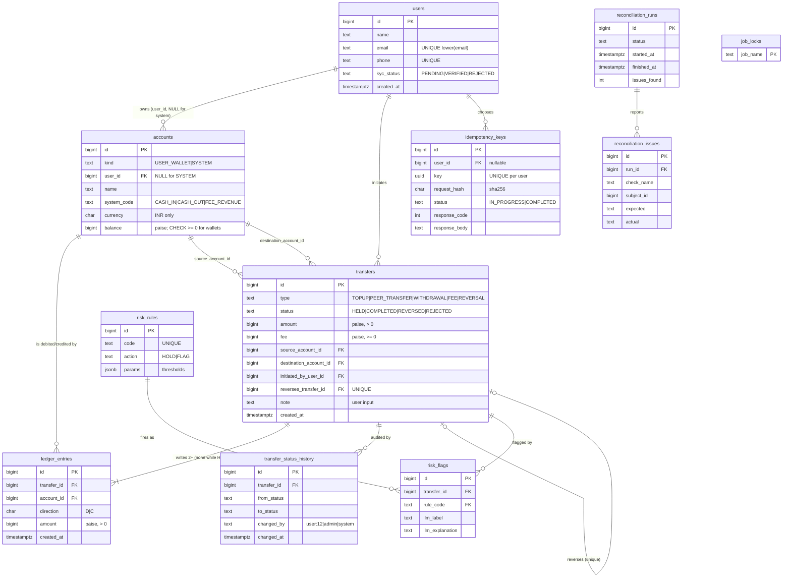

# Milestone 1: schema design

Everything here is implemented in `migrations/001_core.sql` (+ `002`–`004` for later milestones). The schema is built from an empty database by `npm run migrate` (or automatically when the API/worker start).

## 1. Noun list: what became a table, and why

I went through the requirements and listed every noun, then asked: *do we need to store extra facts about it?* If yes → table. If it is just a fact about something else → column.

| Noun in the requirements | Table? | Why |
|---|---|---|
| **user** | ✅ `users` | We store name, email, phone, KYC status about them. |
| name, email, phone, KYC status | column of `users` | Plain facts about a user. |
| **wallet** | ✅ `accounts` (`kind = USER_WALLET`) | Has a balance, a name ("main"/"savings"), an owner, and is the target of ledger entries. |
| **system account** (cash-in, cash-out, fee revenue) | ✅ same table, `kind = SYSTEM` | Same behaviour as a wallet in the ledger; only the owner differs (none). See Q2 below. |
| currency | column (`accounts.currency`, `CHECK = 'INR'`) | One allowed value, no extra facts about it. A `currencies` table would be a table with one row and nothing to say. |
| **transfer** | ✅ `transfers` | The business event: type, status, amount, time, who/what. |
| transfer type, transfer status | column + `CHECK` | A fixed, tiny list with no extra attributes. (If types gained rules/names/limits of their own, they would become a table.) |
| amount, created time | column | Facts about a transfer. |
| **ledger entry** | ✅ `ledger_entries` | One debit/credit line; many per transfer. |
| debit / credit | column (`direction` `D`/`C`) | A two-value attribute of an entry. |
| balance | column (`accounts.balance`), cached | Derived from entries, stored for speed (see Q1). |
| **idempotency key** | ✅ `idempotency_keys` | Stores the key, request hash, status and the saved response. |
| **audit log of status changes** | ✅ `transfer_status_history` | Many rows per transfer: from, to, who, when. |
| **reconciliation report** / **problem found** | ✅ `reconciliation_runs`, `reconciliation_issues` | One row per run (start, end, status, counts); one row per problem (check, id, expected, actual). |
| **job lock** | ✅ `job_locks` | A row to `SELECT … FOR UPDATE NOWAIT` so only one run happens at a time. |
| **fraud rule** | ✅ `risk_rules` | Thresholds must live in data, not code. |
| **flag** (and the LLM's explanation) | ✅ `risk_flags` | One row per (transfer, rule that fired); the explanation and label are columns on it. |
| **statement** | ❌ no table | It is a *query* over `ledger_entries` for one account, newest first. Storing it would duplicate the ledger. |
| **question** (statement Q&A) | ❌ no table | Not required to persist. (A production system would log them for audit; I did not invent that requirement.) |

## 2. Attributes and keys

* Every table has a system-generated `BIGINT GENERATED ALWAYS AS IDENTITY` primary key, plural snake_case table name, singular column names.
* Money: **whole paise in `BIGINT`**. No `FLOAT`/`DOUBLE`/`NUMERIC` anywhere for money.
* Unique-but-not-primary: `users.email` (case-insensitive), `users.phone`, `(accounts.user_id, accounts.name)`, `accounts.system_code`, `(idempotency_keys.user_id, key)`.

## 3. Cardinality decisions (looked at from both sides)

| Relationship | Cardinality | Foreign key placed on | Reasoning |
|---|---|---|---|
| user ↔ wallet | 1 : M | `accounts.user_id` (the "many" side) | A user has many wallets; a wallet has exactly one owner. NULL for system accounts. |
| account ↔ ledger entry | 1 : M | `ledger_entries.account_id` | An account has many entries; **each entry hits exactly one account**. |
| transfer ↔ ledger entry | 1 : M (≥ 2) | `ledger_entries.transfer_id` | A transfer writes two or more entries; an entry belongs to exactly one transfer. |
| transfer ↔ source account / destination account | M : 1 (twice) | `transfers.source_account_id`, `transfers.destination_account_id` | A transfer has one payer and one payee (its *intent*); an account is on many transfers. Needed because **held transfers have no entries yet**, and the risk rules and Q&A query by it. |
| transfer ↔ its reversal | 1 : 0..1 | `transfers.reverses_transfer_id` + `UNIQUE` | A reversal points at exactly one original; an original can be reversed at most once (the unique index makes a concurrent double reversal fail). |
| transfer ↔ status history | 1 : M | `transfer_status_history.transfer_id` | Many status changes per transfer. |
| user ↔ idempotency key | 1 : M (user nullable) | `idempotency_keys.user_id` | A user chooses many keys. NULL for requests with no user yet (`POST /users`) and admin calls. |
| transfer ↔ risk flag | 1 : M | `risk_flags.transfer_id` | Several rules can fire on one transfer. |
| risk rule ↔ risk flag | 1 : M | `risk_flags.rule_code → risk_rules.code` | A rule fires on many transfers. |
| reconciliation run ↔ issue | 1 : M | `reconciliation_issues.run_id` | |
| user ↔ transfer (initiator) | 1 : M, optional | `transfers.initiated_by_user_id` | NULL for system-initiated transfers. |

No **M : N** relationship exists in the requirements, so no mapping table was needed. (A "shared wallet owned by several users" would be the first M:N, needing a `wallet_members` mapping table.)

## 4. ER diagram

## 5. What the database enforces (not just application code)

| Rule from the requirements | Enforced by |
|---|---|
| Amounts are positive; direction stored separately | `ledger_entries.amount CHECK (> 0)`, `direction CHECK IN ('D','C')` |
| A user wallet's balance can never go below zero | `accounts_wallet_nonnegative_ck CHECK (kind = 'SYSTEM' OR balance >= 0)`. System accounts may go negative. |
| Each transfer's debits equal its credits | Deferred **constraint trigger** `ledger_entries_balanced`, checked at `COMMIT` |
| Ledger entries are never updated or deleted | `BEFORE UPDATE OR DELETE` row trigger and `BEFORE TRUNCATE` statement trigger → error `55000` |
| A transfer's money facts never change (only its status) | `transfers_freeze_money` trigger |
| Status history is append-only | same `forbid_modification()` trigger |
| A wallet has an owner; a system account has none | `accounts_owner_ck` |
| A reversal points at an original, at most once | `transfers_reversal_ck` + unique index on `reverses_transfer_id` |
| Idempotency key unique per user | unique index on `(COALESCE(user_id, 0), key)` |
| Currency is INR only | `CHECK (currency = 'INR')` |

Each of these is exercised in `test/basics.test.ts` ("database guard rails") by going **around** the application with raw SQL.

## 6. Indexes, each tied to a real query (and its price)

Every index makes every write slower (measured in `docs/explain.md`, section D: the two ledger indexes make a bulk insert about **3.2×** slower than a bare primary key). So each exists for a named query:

| Index | Query it serves |
|---|---|
| `ledger_entries (account_id, created_at DESC, id DESC)` | The statement: one wallet, newest first, and keyset pagination on `(created_at, id)` |
| `ledger_entries (transfer_id)` | "Entries of transfer X"; the per-transfer balance trigger; the `TRANSFER_BALANCE` reconciliation check (measured ~2× faster with it) |
| `transfers (source_account_id, created_at DESC)` | Fraud rules `VELOCITY` and `DAILY_VOLUME` (measured: 88.7 ms → 0.07 ms for a sender with 300,000 transfers) |
| `transfers (source_account_id, destination_account_id)` | Fraud rule `NEW_RECIPIENT_HIGH` |
| `transfers (destination_account_id, created_at DESC)` | Statement Q&A: "what did I receive in a range?" |
| `transfers (created_at) WHERE status = 'HELD'` | Admin review queue (partial: only HELD rows pay) |
| `risk_flags (created_at) WHERE llm_explained_at IS NULL`, `risk_flags (transfer_id) WHERE reviewed_at IS NULL` | Nightly "what needs explaining?" and "what needs review?" (partial) |
| unique indexes on users/accounts/idempotency | Business rules (see §2, §5) |

**Not indexed on purpose:** `ledger_entries.created_at` alone, `transfers.status` alone (low selectivity), `users.name`.
